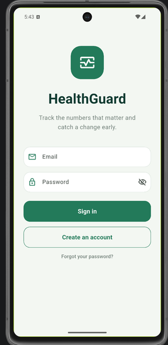
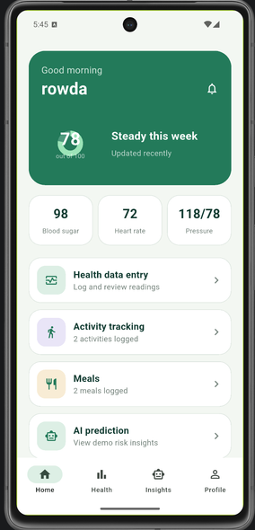
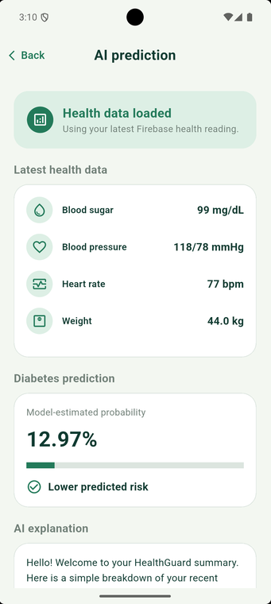

# HealthGuard | Group 32

**AI-powered health monitoring system for preventing chronic diseases**

Senior Graduation Project · University of Sharjah · College of Computing and Informatics · Fall 2026/2027

HealthGuard combines mobile health tracking, diabetes-risk estimation and understandable AI feedback to support early awareness and preventive action. It is an educational system, not a medical diagnosis or a connection to real clinical services.

## Team

- Sara Adel Alamadi
- Hamda Khalifa Alsuwaidi
- Rawdha Abdulaziz Altannak
- Sara Abdulla Alblooshi

Supervisor: Dr. Ibrahim Abaker Hashim

## Features and architecture

- Flutter/Dart patient interface: authentication, health readings, meals, activities, alerts, care team and appointment booking.
- Doctor portal interface and role-based login; see known limitations below.
- Firebase Authentication and Cloud Firestore for user-specific records.
- On-device logistic regression using glucose, diastolic blood pressure and age.
- Gemini via Firebase AI Logic provides explanations and general wellness recommendations; it does not calculate the risk. Firebase App Check protects AI requests.

The architecture has presentation, application and cloud services layers: the Flutter interface collects health information; the application calculates a logistic regression estimate; Firebase Authentication and Firestore manage identity and records; and Firebase AI Logic connects to Gemini for explanations. See the [presentation](documentation/HealthGuard_Presentation.pptx) and [report](documentation/HealthGuard_Final_Report.docx) for diagrams.

## Application screenshots

| Sign in | Dashboard | AI prediction |
| --- | --- | --- |
|  |  |  |

More screens are in [screenshots](screenshots/). These are extracted from the supplied presentation, not newly executed tests.

## Model evaluation

The supplied [Colab notebook](machine_learning/diabetes_logistic_regression.ipynb) uses the Pima Indians Diabetes dataset (768 records), an 80/20 stratified split, random state 42, StandardScaler fitted on training data and logistic regression. Saved notebook outputs report 70.78% accuracy on 154 test records; positive-class precision 0.62, recall 0.44 and F1 0.52. A worked example gives 12.97% estimated probability. These are recorded experimental outputs, not clinical validation or a fresh reproduction.

## Repository contents

- [`mobile_app/lib/`](mobile_app/lib/), [`mobile_app/pubspec.yaml`](mobile_app/pubspec.yaml): supplied Flutter source and dependencies.
- [`machine_learning/`](machine_learning/): original training notebook.
- [`firebase/`](firebase/): supplied security rules and setup notes.
- [`documentation/`](documentation/): [final report](documentation/HealthGuard_Final_Report.docx), [presentation](documentation/HealthGuard_Presentation.pptx), and [poster](documentation/HealthGuard_Poster.pdf).
- [`screenshots/`](screenshots/): selected application screenshots.
- [`testing/`](testing/): recorded evidence and remaining checks.

## Build and setup

The supplied source archive contains only `lib/` and `pubspec.yaml`, not the complete Android project. Use the team's original working Flutter project to build, retaining its Android configuration and application ID. Copy the source into a backup of that project, run `flutter pub get`, configure Firebase for the authorized project, and use `flutter run` on an emulator or connected device. For a new project, generate the platform scaffolding and configure Firebase before running. See [Firebase setup notes](firebase/README.md).

## Known limitations

The supplied snapshot is preserved, not patched: registration omits the patient role required by the supplied rules; the doctor patient list queries `doctorPatients`, which is not covered by the rules; patient details are static cards; doctor access to patient health records is not authorized by these rules. Appointment retrieval depends on correct doctor UID and query/index configuration. Some dashboard/alert content and care-team functions are illustrative. See the report for scope and limitations.

## Privacy and sharing

Keep this repository private. Original academic documents and screenshots may contain student IDs, account identifiers and sample health information. The supplied app logs user IDs, email addresses and meal details during debugging; review log handling before use with real data. Review and redact before any wider sharing. Do not commit actual patient records, passwords, debug secrets, service-account credentials or signing keys. No production deployment or new test execution was performed during packaging.
